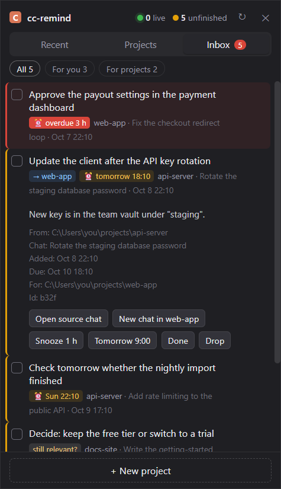

# cc-remind

**A durable reminder inbox shared by every Claude Code session on your machine, with a Windows desktop widget.**
Notes addressed to a *project* wait until the next session opens there. Notes addressed to *you* raise a desktop notification when they fall due. Whoever closes an item is recorded.

> [!WARNING]
> **Experimental.** Built and used daily by one person on one Windows 11 machine since 2026-09-30. Last tested on Claude Code 2.1.308, Node.js 22 and Windows PowerShell 5.1 (2026-10-22; first release tested on 2.1.295). It reads some Claude Code files whose format is not documented (see [Relies on undocumented Claude Code files](#relies-on-undocumented-claude-code-files)), so expect breakage after Claude Code updates. Not published to npm.



**TL;DR**
- If you run several Claude Code projects in parallel, sessions regularly end with something that is not their own job: a decision only you can make, a result to check tomorrow, or a fact that a *different* project's session needs to know.
- Claude Code's own [cross-session messaging](https://code.claude.com/docs/en/cross-session-messaging) is **live**: on one machine it delivers only to sessions that are running now. These handoffs are usually for a project that has no session open, possibly for days.
- `cc-remind` is a single-file Node CLI with no dependencies, plus a `SessionStart` hook. Items are addressed to a project folder or to "me". The hook shows a project its open items when any session starts there. The agent closes an item with a one-line note when it finishes the work.
- The optional widget lists recent sessions, resumes any of them in Windows Terminal, and shows the inbox with due-time notifications. It asks WebView2 to use less memory while it is hidden or covered by another window.
- Bonus: a script that forks each project's latest conversation headless (`--resume <id> --fork-session`) and asks it, read-only, which of its own open items are already done.

---

## The problem: handoffs outlive the session that wrote them

With one project, a `TODO.md` works. With many projects running in parallel, three things go wrong:

1. **Notes for another project never arrive.** Session A learns something project B needs (a shared server changed, an API key rotated, a library has a bug). A writes it into its own notes and B never reads them.
2. **Things only you can do get lost.** "Approve the payment", "check the result on Thursday", "pick option A or B". These end up in long markdown files that nobody re-reads. Before this tool, my single shared to-do file had grown to about 1,800 lines with 19 open sections.
3. **Work gets done but the item stays open.** This was the most common failure. A later session finishes the work, says "done" in chat, and the to-do list still shows it open two weeks later. A list you cannot trust stops being read.

### Why not the built-in options?

| Option | What it is good at | Why it did not cover this |
|---|---|---|
| [Cross-session messaging](https://code.claude.com/docs/en/cross-session-messaging) (`SendMessage` / `ListAgents`) | Live hand-over between sessions that are running at the same time | On one machine it reaches live sessions only. The target project often has no session open. It has no due times, no human to-do list, and no record of who closed what. |
| [Shared task list](https://code.claude.com/docs/en/env-vars) (`CLAUDE_CODE_TASK_LIST_ID`) | Several sessions working one task list | Sessions must be started with the same ID on purpose. It is not addressed to a project folder, and it has no due-time notifications for a human. |
| Peer-messaging MCP servers such as [claude-peers-mcp](https://github.com/louislva/claude-peers-mcp) and [MCP Agent Mail](https://github.com/Dicklesworthstone/mcp_agent_mail) | Agent-to-agent mail with identities and threads; Agent Mail also persists history | They need a running server and agent registration, and the agent has to check its inbox. I wanted zero infrastructure: a JSON file plus a hook that injects the items without the agent having to ask. |
| Windows session browsers | Browsing and resuming past sessions | They cover the widget's session list, not a reminder inbox. |

`cc-remind` is the small piece in between: **durable, addressed to a project, pushed into context at session start, closed with attribution.** If your sessions mostly run at the same time, use the built-in messaging instead.

---

## Design

```
 any session (Bash / PowerShell tool)              desktop widget (PowerShell + WebView2)
   cc-remind add "..." --to <project>                every 20 s: cc.mjs scan --out scan.json
   cc-remind done <id> "what I did"                  shows sessions + inbox, notifies when due
            |                                                     |
            v                                                     v
      +------------------------------ todos.json -------------------------------+
      | { id, title, note, pr, to: <project path|null>, due,                    |
      |   from: { sessionId, cwd, title }, doneAt, doneBy, doneNote, dropped }  |
      +-------------------------------------------------------------------------+
            ^
            |  SessionStart hook: cc-remind hook-start  (reads hook JSON on stdin)
            |  prints open items for this folder, most urgent first (max 8)
            |
 next session that opens in <project>
```

**Decisions that mattered**

- **Address projects, not sessions.** `--to` resolves a short name ("api-server") against the project folders seen in Claude Code's transcripts, or takes a folder path. Session ids go stale and folders do not. The item reaches whichever session opens in that folder next, including a subfolder of it.
- **Push, don't poll.** The `SessionStart` hook prints the items to stdout, so they land in the new session's context without the agent calling a tool. It shows at most 8. Overdue and soonest-due items always come first, across both groups, and the rest is summarised as "...and N more (M of them overdue)".
- **Record the source automatically.** `add` reads `CLAUDE_CODE_SESSION_ID` and `CLAUDE_PID`, which Claude Code [sets in tool and hook subprocesses](https://code.claude.com/docs/en/env-vars), plus the session's title from its transcript. Each item knows which chat raised it, so the widget can reopen that chat in one click.
- **Closing is part of finishing.** The skill tells the agent: before you say a task is done, check `cc-remind list` and close the matching item. `done` stores who closed it (session, project, title) and a one-line note. The widget then shows a notification like "Closed: X, by the chat in project Z", so you see completions you did not ask about.
- **One item = one task.** Bundled items never get closed because they are never fully done. Splitting them is the rule the agent follows most reliably.
- **Staleness is visible.** Items open more than 14 days are flagged "still relevant?", and the agent is told to close one if it can prove the item is obsolete.
- **Plain files, one lock.** `todos.json` is written via temp file + rename under an exclusive lock file (5 s wait, a stale lock is broken after 10 s). The scanner keeps a byte-offset cache per transcript, so each 20-second rescan reads only the new bytes.
- **One time zone.** `--due` is read and every time is shown in the same time zone: the machine's by default, or `timeZone` in the config.

### Usage

```text
cc-remind add "<one concrete task>" [--to me|<project>] [--due "YYYY-MM-DD HH:mm"|+2h|+3d|tomorrow9] [--pr hi|mid|lo] [--note "..."]
cc-remind done <id> "<what was done>"
cc-remind done <id> --dropped "<why it is no longer needed>"
cc-remind list [--all] [--notes]
cc-remind show <id> [<id>...]
cc-remind snooze <id> "<due>"
cc-remind edit <id> [--title ...] [--due ...|none] [--pr ...] [--note ...] [--to ...]
cc-remind reopen <id>
cc-remind paths          # where the data and config live, and the time zone in use
```

What a new session in a project sees, injected by the hook:

```text
[cc-remind] Open reminders for this project: 3 open, 1 overdue (times in Europe/Berlin):
Addressed to this project - handle them when relevant, then close with `cc-remind done <id> "<what you did>"` and tell the user in one line:
  [b32f] (mid) -> web-app due 2026-10-12 10:00 :: update the client after the API key rotation  <from api-server / Rotate the staging password, 2026-10-08>
The user's to-dos raised from this project - if the user says one is done, or you finish it, close it with `cc-remind done <id>`:
  OVERDUE [9c1e] (hi) you due 2026-10-09 18:00 :: approve the payout settings  <from web-app / Fix the checkout redirect, 2026-10-07>
  [4d07] (mid) you :: decide whether to keep the free tier  <from web-app / Pricing page, 2026-10-08>
```

---

## Install (Windows)

Requirements: Windows 10/11, Node.js 18+, Claude Code. For the widget: the [WebView2 Runtime](https://developer.microsoft.com/microsoft-edge/webview2/) (built into Windows 11) and, for resume, Windows Terminal. For the review script: PowerShell 7.

```powershell
git clone https://github.com/MankhongGarden/cc-remind
cd cc-remind
powershell -ExecutionPolicy Bypass -File install\install.ps1 -AddToPath -InstallSkill
```

The installer:
- creates the data folder (`%LOCALAPPDATA%\cc-remind`, or `CC_REMIND_DATA`) and a `config.json` from `config.example.json`;
- downloads the WebView2 SDK from NuGet (pinned version, SHA-256 and Microsoft signature checked) into `lib\`. The DLLs are not in this repository;
- with `-AddToPath`, adds `bin\` to your user PATH; with `-InstallSkill`, copies `skill\SKILL.md` into your Claude Code config dir;
- **does not edit your Claude Code `settings.json` or `CLAUDE.md`.** It prints the hook snippet and an optional `CLAUDE.md` line for you to paste.

Add the hook yourself (user or project `settings.json`):

```json
{
  "hooks": {
    "SessionStart": [
      { "hooks": [ { "type": "command", "command": "cc-remind hook-start", "timeout": 10 } ] }
    ]
  }
}
```

Start the widget with `wscript launch.vbs`, or add that command to Task Scheduler / your Startup folder.

The CLI and hook are plain Node and also run on macOS and Linux (data in `~/.local/state/cc-remind`); the widget and installer are Windows-only.

### Configuration

`config.json` in the data folder (all fields optional):

| Key | Default | Meaning |
|---|---|---|
| `timeZone` | machine time zone | IANA name such as `Europe/Berlin`. Used to read `--due` and to show every time. Env: `CC_REMIND_TZ` |
| `language` | `en` | Widget and notification language: `en` or `th`. Env: `CC_REMIND_LANG` |
| `claudeConfigDir` | `CLAUDE_CONFIG_DIR`, else `~/.claude` | Where Claude Code keeps `projects/` and `sessions/` |
| `launchCommand` | `claude` | Command the widget runs for "resume" and "new chat" |
| `resumeArgs` | `[]` | Extra arguments added when resuming, e.g. `["--model", "opus"]` |
| `closeSkills` | `[]` | Names of your own wrap-up skills or slash commands that mark a session as finished (`/compact` always does) |
| `ignorePaths` | `[]` | Folders whose sessions are left out of the session list and of `--to` name matching, e.g. bots or scripts that run Claude Code headless. A plain name (`"my-bot"`) matches that folder name anywhere in the path; an entry with a slash (`"C:/tools/scratch"`) matches that folder and everything under it. System temp folders are always left out |
| `projectRoots` | `[]` | `[{ "label": "Projects", "path": "C:\\code" }]` enables the widget's "New project" button for these folders |

The data folder itself is set with the `CC_REMIND_DATA` environment variable.

---

## Backlog triage by forking each project's own conversation

Moving to `cc-remind` meant migrating the old to-do file: 91 items across 19 open sections. Many were probably already done, but only the project that did the work could tell.

`review/run-review.ps1` asks each project to triage its own items, without touching its real conversation:

```powershell
claude -p $prompt `
  --resume <that project's latest session id> --fork-session `
  --model sonnet --permission-mode dontAsk --max-turns 60 `
  --allowedTools Read Grep Glob "Bash(cc-remind:*)" "Bash(git status:*)" "Bash(git log:*)" "Bash(git remote:*)" `
  --disallowedTools Edit Write NotebookEdit WebFetch
```

- `--resume ... --fork-session` starts a new session that carries the project's full history, so the reviewer remembers why each item was written. The original conversation keeps its own id, which is what `--fork-session` is documented to do.
- The prompt sets three outcomes per item: close it as done with evidence, close it as dropped with a reason, or leave it open. Anything that needs your decision must be left open and listed as a question. This is the rule that matters.
- Tools are read-only plus `cc-remind` and `git` read commands. Runs go 4 at a time (`ForEach-Object -Parallel`) with a 25-minute kill timeout. Each report is written to `<data folder>\review\<project>.md`.
- The runner strips `CLAUDECODE`, `CLAUDE_CODE_*` and `CLAUDE_PID` from the child environment. Otherwise the child would inherit the parent session's id and record items under the wrong source.
- By default it reviews every project that has open items addressed to it, using that folder's most recent session. `review.config.json` in the data folder can pin the list, model, turns and parallelism (see `review/review.config.example.json`). `-DryRun` shows what would run.

**What happened in the one real run (2026-09-30, 7 projects):** every run exited 0, taking 1-4 minutes each. The reviewers were conservative: they closed only items with evidence they could point to (for example, git history showing a "push or discard?" commit had already been pushed) and left every judgement call open, which is what I wanted. The value was less the closures than the short list of questions, which let me clear dozens of items in one sitting.

This needs only the documented `--resume`, `--fork-session` and `-p` flags, so the idea works without the rest of `cc-remind`: fork a project's own context and ask it to audit its own backlog read-only.

---

## Limitations

### Relies on undocumented Claude Code files

The scanner reads `<config>/projects/*/*.jsonl` transcripts, matching on internal record shapes (`"type":"ai-title"`, `"subtype":"compact_boundary"`, the first user message). It also reads `<config>/sessions/<pid>.json` to tell which sessions are live. **Neither format is a public API.** Both still parsed on Claude Code 2.1.308 (2026-10-22), but an update can break the widget's session list, titles and "live" dots without any error. Reminders themselves (`add`, `done`, `list`, the hook) do not depend on these files, except that `--to <short name>` uses the scanned project list (a folder path always works).

### Other limits

- **The agent has to cooperate.** Closing depends on the agent following the skill. It usually does, but sometimes it finishes work without closing the item, so the 14-day staleness flag is still needed.
- **Hook output is capped at 8 items.** Overdue and soonest-due items are always among them, and the hook tells the agent to run `cc-remind list` when more exist.
- **Single machine, single user.** It uses a local JSON file and a lock file, with no sync. Don't put the data folder in a cloud-synced folder that another machine writes to.
- **Windows-only widget.** It uses WinForms + WebView2 from PowerShell, Windows Terminal for resume, and UI Automation to pick the right terminal tab.
- **The fork-session review uses quota.** Each `claude -p` run is a full agent session. Pin a smaller model and cap `--max-turns`.
- **Memory trim needs a recent WebView2 Runtime.** While the widget is hidden or another app is in front, it sets WebView2's memory target to `Low` and back to `Normal` when you are on the desktop or using the widget. On a runtime without that setting it logs one line and carries on.
- **The widget re-scans every 20 seconds.** With the byte-offset cache this is cheap after the first run. The first scan reads every transcript once.
- A note or title cannot start with `--` (it would be read as a flag); put `--` before it, e.g. `cc-remind add -- "--force was needed"`.

---

## Development

```powershell
npm test            # node --test, uses a temporary data folder
```

`widget.ps1 -Test -ShotFile <file> -ShotDir <dir>` runs the widget headless-ish, executes one line of JavaScript from the file per step, and saves a PNG after each.

## Changes

**0.2.0 (2026-10-22)**
- `ignorePaths` in `config.json` hides sessions from chosen folders (headless bots, scratch folders) in the widget and in `--to` name matching.
- The widget lowers WebView2's memory target while it is hidden or covered, and restores it on the desktop or when focused.
- Skill: clearer rules for notes to other projects and self follow-ups, plus Windows/PowerShell quoting and auto-mode pitfalls.

**0.1.0 (2026-10-09)** - first public release.

## License

MIT, see [LICENSE](LICENSE). The WebView2 SDK is not included in this repository; the installer downloads it from NuGet under Microsoft's license (copied to `lib\WebView2-LICENSE.txt`).
